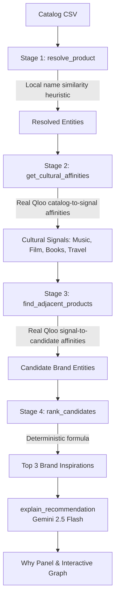

# Cultivar

> **Cultural Brand Inspiration for Independent Coffee Roasters**  
> *Built for the Qloo Agentic Hackathon*

---

## What Cultivar Does

Cultivar is a decision-support workspace for independent specialty coffee roasters. It explores the cultural ecosystem around a coffee roaster's catalog and surfaces adjacent brand inspirations from Qloo's taste graph.

When roasting companies plan new offerings, seasonal drops, retail collaborations, or packaging narratives, they often rely on guesswork or menu ingredient trends that are already saturated.

Cultivar connects a coffee catalog to **Qloo's cross-domain taste graph** (music, film, literature, destinations, fashion) through a 4-stage pipeline:

1. **Entity Resolution**: Maps catalog products to entities in Qloo search.
2. **Cultural Signal Discovery**: Retrieves cross-domain audience taste affinities (artists, films, books, places, brands).
3. **Brand Discovery**: Queries Qloo for existing brand entities that share audience affinity with those cultural signals.
4. **Deterministic Ranking**: Ranks candidate brand inspirations mathematically using real Qloo affinity values and catalog category novelty.

An audit trail (**The Why Panel**) displays the exact Qloo request URLs, raw API responses, and scoring formula for every recommendation, while Gemini 2.5 Flash generates a concise 1-sentence cultural explanation.

```
Producer Catalog CSV  ──>  Qloo Taste Graph  ──>  Cross-Domain Signals  ──>  Adjacent Brand Inspirations
(Beans, Roasts, RTD)       (Search & Insights)    (Music, Film, Books)       (Audit Trail & Explanations)
```

---

## Important Product Framing

- **Existing Brands as Cultural Inspiration**: Because Qloo's public entity model classifies adjacent commercial entities under `urn:entity:brand`, Cultivar surfaces **existing brands** rather than newly invented packaged recipes. These serve as **cultural and brand inspirations**—benchmarks for brand positioning, potential retail partnerships, or aesthetic and flavor cues.
- **Affinity vs. Demand**: Qloo affinity measures audience taste overlap between two cultural entities. It does **not** prove commercial demand, forecast sales, or guarantee product viability.
- **Decision Support**: Cultivar is a planning aid. Roasters must independently verify green coffee supply chains, roasting profiles, and packaging economics.

---

## Pipeline & Scoring Formula

Cultivar uses a 4-stage deterministic pipeline. Scoring is calculated directly from Qloo API affinity values without LLM scoring:



### Deterministic Scoring Formula
Every candidate's raw score is computed as:

$$\text{rawScore} = \text{totalAffinity} \times \ln(\text{signalCount} + 1) \times \text{noveltyBonus}$$

Where:
- $\text{totalAffinity}$: The sum of real Qloo signal-to-candidate affinities ($\text{candidateAffinity}$) across signals that surfaced the candidate in Stage 3.
- $\text{signalCount}$: The number of distinct cultural signals linking the candidate to the roaster's catalog (minimum 2 required).
- $\text{noveltyBonus}$: $1.5\times$ if no word of the candidate's category matches any catalog category; $1.0\times$ otherwise.

### Relative Rank Score
To avoid implying a probability of success, candidate scores are presented as a **relative rank score** indexed to the highest-scoring candidate in the run:

$$\text{Relative Rank Score} = \text{round}\left(\frac{\text{rawScore}}{\text{topScore}} \times 100\right)$$

The top match receives $100 / 100$. This score reflects relative rank within the catalog run, **not** a probability of commercial success.

---

## Evidence & The Why Panel

Cultivar enforces full traceability for every displayed score:
- **No Synthetic Affinities**: Supporting signals displayed for a candidate are strictly those that returned the candidate from Qloo with a real `candidateAffinity`. No affinities are guessed, estimated, or fabricated.
- **Two-Hop Graph Traceability**: Displays both Qloo links:
  1. $\text{Catalog Item} \rightarrow \text{Cultural Signal}$ ($\text{affinity}$, Stage 2)
  2. $\text{Cultural Signal} \rightarrow \text{Candidate Brand}$ ($\text{candidateAffinity}$, Stage 3)
- **Exact Qloo Request URLs**: Collapsible panels show the exact GET requests dispatched to the Qloo API.
- **Raw API Payloads**: Real JSON returned by Qloo, inspectable in full or as relevant entity slices.
- **Interactive Cultural Graph**: Visualizes the 2-hop network using `react-force-graph-2d` with Tableau 10 color-blind safe palettes.

---

## Workflow Comparison (`/compare`)

The `/compare` screen presents an **illustrative comparison of two different product workflows**:

| Dimension | Workflow A: Direct LLM Ideation | Workflow B: Cultivar (Qloo + Gemini) |
| :--- | :--- | :--- |
| **Method** | Gemini 2.5 Flash prompts with product names & categories alone | 4-stage pipeline: Qloo taste graph discovery + Gemini narrative |
| **Output Type** | Direct new product concepts (e.g., RTD cans, spreads) | Existing brand entities serving as cultural inspirations |
| **Grounding** | 0 external taste entities | Multi-domain cultural entities with verified Qloo affinities |
| **Auditability** | None (LLM internal priors) | Full (exact Qloo URLs, entity IDs, raw API payloads) |
| **Role of LLM** | Ideation & concept generation | One-sentence narrative synthesis of Qloo graph links |

If the generic Gemini call is unavailable or rate-limited, Cultivar returns a static fallback flagged with `isFallback: true` and displays a clear badge in the UI.

---

## Seasonality & Memory

- **Seasonal Keyword Weighting**: Target launch months apply illustrative keyword weights (e.g., boosting signals related to winter or harvest). This is a **heuristic keyword multiplier** for demo illustration, not live market trends or Qloo time-series data. Displayed Qloo affinities remain unchanged.
- **Decision Memory**: Producer feedback ("I'll try this" / "Not for us") is stored in **browser-local storage** (`localStorage` key `cultivar:memory`) and a local demo file (`data/memory.json`). This is single-user demo state, not durable or multi-tenant cloud storage. Saved decisions provide context for subsequent Gemini explanation prompts.

---

## Tool Architecture & Model Context Protocol (MCP)

Cultivar's engine is structured as 8 discrete tools with strict Zod validation, available via internal functions and an MCP server (`stdio` transport):

1. `resolve_product`: Resolves a catalog product name against Qloo entity search.
2. `get_cultural_affinities`: Fetches cross-domain cultural taste signals (music, film, books, travel) for an entity from Qloo.
3. `find_adjacent_products`: Surfaces adjacent brand entities sharing audience affinity with a cultural signal.
4. `rank_candidates`: Ranks candidates by $\text{totalAffinity} \times \ln(\text{signalCount} + 1) \times \text{noveltyBonus}$.
5. `explain_recommendation`: Synthesizes a one-sentence cultural narrative using Gemini 2.5 Flash.
6. `remember_recommendation`: Stores a recommendation evaluation (accepted/rejected) in local memory.
7. `recall_past_recommendations`: Retrieves past saved evaluations from local memory.
8. `seasonal_trends`: Illustrative keyword anchor query against Qloo for seasonal demo signals.

To run the MCP server:
```bash
npm run mcp
```

---

## Validation Status

### What the Prototype Demonstrates
- Functional integration with Qloo's Search and Insights APIs to resolve products and query cross-domain affinities.
- Real 2-hop graph navigation from catalog products to cultural signals (musicians, movies, books, destinations) to adjacent brand entities.
- Deterministic mathematical ranking and non-hallucinatory evidence trails (Why Panel).
- Interactive 2D force-directed graph visualization and workflow comparison against ungrounded LLM ideation.

### What Qloo Affinity Does and Does Not Establish
- **Does establish**: Qloo affinity establishes that audiences who engage with entity A exhibit a statistically significant co-preference or affinity for entity B across cultural domains.
- **Does not establish**: Qloo affinity does not prove commercial purchase demand, willingness to pay, unit economics, or production feasibility for a new physical SKU.

### Missing Customer Validation
- **No real customer evidence has been collected yet**: No formal interviews, commercial trials, or blind product evaluations have been conducted with independent coffee roasters.
- The app's sample roaster catalog and seasonal scenarios are illustrative demo data.

### Concrete Method for Future Roaster Validation
To validate Cultivar with real independent specialty coffee roasters:
1. **Recruitment**: Recruit 5–8 head roasters or green coffee buyers from regional specialty roasting companies (e.g., in the Pacific Northwest).
2. **Catalog Run**: Upload their actual current coffee lineup (single origins, espresso blends, decaf, cold brew).
3. **Double-Blind Concept Review**: Present each roaster with 3 Qloo-derived brand inspirations and 3 ungrounded LLM product concepts without labeling the source.
4. **Structured Evaluation**: Have roasters score each concept on:
   - *Plausibility*: Does this fit your audience profile?
   - *Novelty*: Is this an idea or adjacency you hadn't considered?
   - *Actionability*: Would you initiate a seasonal collab, retail pairing, or flavor profile test based on this?
5. **Success Criteria**: If at least 60% of roasters rate Qloo-derived inspirations as more culturally resonant and actionable than ungrounded LLM ideas, proceed to pilot partnership workflows.

---

## Tech Stack

- **Framework**: Next.js 15 (App Router) & React 19
- **Styling**: Tailwind CSS v4 & Radix UI primitives
- **Cultural Taste Intelligence**: Qloo API (Search & Insights v2)
- **Language Model**: Google Gemini 2.5 Flash (`@google/genai` SDK)
- **Agent Protocols**: Model Context Protocol (`@modelcontextprotocol/sdk`)
- **Graph Visualization**: `react-force-graph-2d` (HTML5 Canvas) & `html-to-image`
- **Language & Runtime**: TypeScript 5 & Node.js 20+

---

## Local Setup

### 1. Clone the repository
```bash
git clone https://github.com/NOBA235/cultivar.git
cd cultivar
```

### 2. Install dependencies
```bash
npm install
```

### 3. Configure environment variables
Create a `.env.local` file in the project root:
```env
QLOO_API_KEY=your_qloo_api_key_here
GEMINI_API_KEY=your_gemini_api_key_here
```

### 4. Run the development server
```bash
npm run dev
```
Open [http://localhost:3000](http://localhost:3000) in your browser.

---

## License

This project is licensed under the MIT License - see the [LICENSE](LICENSE) file for details.
Built for the **Qloo Agentic Hackathon**. Powered by Qloo's cross-domain taste graph. Explanations by Gemini 2.5 Flash.
