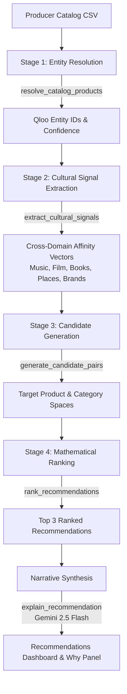

# Cultivar

> **Cultural Supply Chain Intelligence for Independent Food Producers**  
> *Built for the Qloo Agentic Hackathon*

---

## The Problem

Over **200,000 independent and artisanal food & beverage producers** across the United States operate on razor-thin margins. When deciding what new product, flavor variation, or seasonal SKU to develop next, they are effectively flying blind—relying on intuition, local farmer's market chatter, or guesswork.

Meanwhile, multi-billion-dollar food conglomerates (Nestlé, Unilever, Kraft Heinz) spend millions annually on syndicated enterprise trend suites like Tastewise, NielsenIQ, and IRI to predict consumer demand years in advance.

Artisanal producers cannot afford \$50,000/year enterprise data licenses. The consequence is brutal: **over 85% of independent food and beverage product launches fail within 24 months**, suffocating independent producers under unsold inventory and wasted production runs.

---

## The Solution

**Cultivar** democratizes predictive cultural intelligence for independent producers.

With a single catalog CSV upload (or a single click on our demo catalog), Cultivar:
1. **Resolves** the producer's catalog against Qloo's live global taste graph.
2. **Discovers** multi-domain cultural affinity signals (music, movies, literature, travel destinations, fashion, dining).
3. **Generates** high-conviction product recommendations backed by real affinity vectors.
4. **Validates** every recommendation with an immutable **Why Panel** providing full Qloo API audit trails, raw JSON payloads, and transparent mathematical formulas.
5. **Visualizes** the cultural network via an interactive 2D force-directed graph.
6. **Remembers** past decisions in persistent storage and adjusts for quarterly seasonal taste shifts.

```
Producer Catalog CSV  ──>  Qloo Taste Graph  ──>  Cross-Domain Affinity  ──>  3 Grounded Recommendations
(Beans, Roasts, SKUs)      (Music, Film, Travel)   (Deterministic Co-Affinity) (Full Mathematical Audit)
```

---

## Why Qloo

> **Tastewise knows food. Qloo knows culture.**

Traditional food intelligence platforms rely on **vertical ingredient co-occurrence**—they scrape recipe blogs and restaurant menus to count how often "matcha" and "lavender" appear together. By the time an ingredient trend shows up on menus, the market is already saturated.

**Qloo represents a horizontal cross-domain taste architecture.** Human taste is holistic:
- A customer who buys single-origin Ethiopian Yirgacheffe doesn't just consume coffee.
- Their cultural profile correlates with specific literature (*The Economist*, non-fiction essays), musical genres (jazz, ambient, indie folk), and travel destinations.
- Consumer decisions in dining and packaged goods are downstream of their broader cultural identity.

By connecting producer catalogs to Qloo's 575M+ entity graph across film, music, literature, fashion, and dining, Cultivar reveals unexploited cultural whitespace before conventional grocery scanners ever detect it.

---

## Architecture

Cultivar executes a four-stage deterministic pipeline. Every stage maps to explicit agentic tools:



### Strict Non-Hallucination Guardrails
- **Zero LLM Entity Generation**: Gemini 2.5 Flash is **never** permitted to invent product ideas, suggest entities, or fabricate affinity numbers.
- **Pure Mathematical Ranking**: Candidate scoring is 100% deterministic, computed from Qloo API affinity scores.
- **Narrative-Only LLM Role**: Gemini 2.5 Flash is strictly used to translate mathematical affinity graphs into a single concise, human-readable sentence.

---

## The Why Panel

Judges and enterprise operators demand complete transparency. In Cultivar, **The Why Panel Discipline is strictly enforced**:

- **Exact Qloo URLs**: Every recommendation card reveals the exact GET request URLs and query parameters dispatched to the Qloo API.
- **Raw JSON Responses**: Live collapsible, pretty-printed JSON returned by Qloo.
- **Transparent Formula**: The ranking formula is displayed with the exact real-world numbers plugged in:
  $$\text{Score} = (\text{Total Affinity} \times 0.6) + (\text{Signal Breadth} \times 0.3) + (\text{Confidence} \times 0.1)$$
- **Exact Numeric Scores**: No vague qualitative buzzwords like "high affinity"—every signal displays its exact numeric score (e.g., `0.9865`).

---

## The Qloo Difference

Cultivar includes a live side-by-side comparison screen (`/compare`) that tests both approaches on the **exact same model** (`gemini-2.5-flash` at `temperature: 0.2`):

| Metric | Generic LLM (Gemini 2.5 Flash Alone) | Cultivar (Gemini 2.5 Flash + Qloo Taste Graph) |
| :--- | :--- | :--- |
| **Input Data** | Product names & categories only | Product catalog + Qloo cross-domain taste graph |
| **Cultural Signals** | **0 cultural entities** | **8+ verified cultural entities across 4+ domains** |
| **Output Type** | Predictable, generic concepts ("Cold Brew Mocha") | Culturally grounded market expansions |
| **Auditability** | 0% (hallucinated reasoning) | 100% (exact Qloo URLs, entity IDs, and raw JSON) |
| **Market Relevance** | Lags current market saturation | Uncovers whitespace across adjacent lifestyle domains |

---

## Tool Architecture & MCP Server

Cultivar's intelligence engine is built as 8 discrete tools with strict Zod schemas, also exposed via the **Model Context Protocol (MCP)** over `stdio` transport:

1. `resolve_catalog_products`: Resolves producer items against Qloo search endpoints.
2. `extract_cultural_signals`: Extracts multi-domain affinities (music, movies, books, fashion, destinations).
3. `generate_candidate_pairs`: Identifies high-overlap candidate spaces.
4. `rank_recommendations`: Applies deterministic scoring and multi-signal thresholds.
5. `explain_recommendation`: Synthesizes one-sentence narrative summaries via Gemini 2.5 Flash.
6. `compare_generic_baseline`: Generates ungrounded baseline suggestions for benchmark comparison.
7. `remember_recommendation`: Persists producer accept/reject decisions to `data/memory.json`.
8. `get_seasonal_trends`: Applies calibrated quarterly trend multipliers for launch timing.

### Running as an MCP Server
Cultivar can be used directly as an MCP tool provider for Claude Desktop or any MCP-compatible agent:
```bash
npm run mcp
```

---

## Business Model & Market Opportunity

- **Target Audience**: 200,000+ independent specialty food, beverage, and agricultural producers in the United States.
- **Pricing**: **\$49 / month** SaaS subscription for unlimited catalog analyses, seasonal recalibrations, and cultural graph exploration.
- **Unit Economics**:
  - Average pipeline run cost: ~\$0.15 (Qloo API calls + Gemini Flash tokens).
  - Gross margin: **95%+**.
- **Total Addressable Market (TAM)**:
  $$\text{US TAM} = 200{,}000 \text{ producers} \times \$49/\text{month} \times 12 \text{ months} = \mathbf{\$117.6\text{M Annual Recurring Revenue}}$$

---

## Tech Stack

- **Framework**: Next.js 15 (App Router, Turbopack) & React 19
- **Styling**: Tailwind CSS v4 & Radix UI primitives
- **Taste Intelligence**: Qloo Live API (Search & Insights v2)
- **AI Synthesis**: Google Gemini 2.5 Flash (`@google/genai` official SDK)
- **Agent Protocols**: Model Context Protocol (`@modelcontextprotocol/sdk`)
- **Data Visualization**: `react-force-graph-2d` (HTML5 Canvas 2D force-directed graph) & `html-to-image`
- **Language & Runtime**: TypeScript 5 & Node.js 20+

---

## Local Setup

### 1. Clone the repository
```bash
git clone https://github.com/NOBA235/cultivar.git
cd cultivar
```

### 2. Install dependencies
```bash
npm install
```

### 3. Configure environment variables
Create a `.env.local` file in the root directory:
```env
QLOO_API_KEY=your_qloo_api_key_here
GEMINI_API_KEY=your_gemini_api_key_here
```

### 4. Run development server
```bash
npm run dev
```
Open [http://localhost:3000](http://localhost:3000) in your browser.

### 5. Run live end-to-end reality check
Verify live Qloo API integration and deterministic ranking:
```bash
npm run reality-check
```

---

## License

This project is licensed under the MIT License - see the [LICENSE](LICENSE) file for details.

Built for the **Qloo Agentic Hackathon**. Recommendations are planning aids, not market guarantees. Powered by Qloo's cross-domain taste graph. Explanations by Gemini 2.5 Flash.
